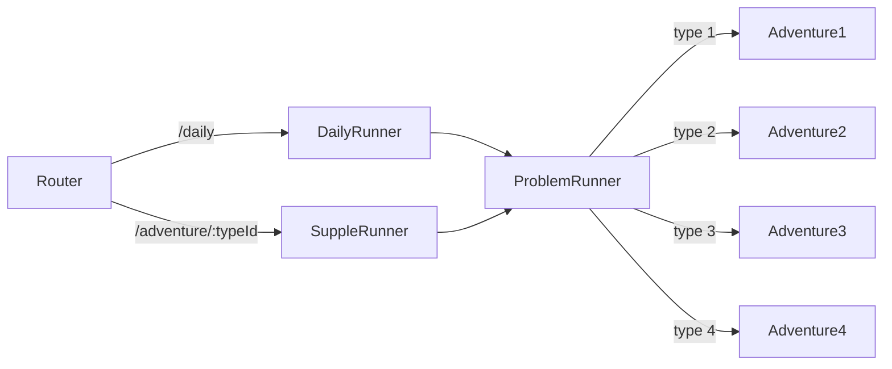

# Adventure-admin

## 1. 일일탐험 문제 조회 : /api/student/{student-id}/adventure/problem

## API 설명

학생의 일일 탐험 문제를 조회합니다. 

완료 하지 않은 문제들의 목록이 뜨며, 이전에 문제를 3문제를 풀었다가 이어하는 상황이라면

문제 목록은 7문제가 제공됩니다.

## Request

| 요청 형식 | path |
| --- | --- |

| 자료형 (Java) | 변수명 | 설명 | Nullable |
| --- | --- | --- | --- |
| Long | studentId | 학생 ID(PK) | X |

**예시**

```json
/api/student/4/adventure/problem
```

## Response

| 자료형 (Java) | 변수명 | 설명 | Nullable |
| --- | --- | --- | --- |
| List<Problem> | problems | 탐험 문제 배열 | X |
| Integer | dayProblemId | 문제 고유 ID (PK) | X |
| Integer | studentId | 학생 ID | X |
| Integer | interestId | 관심사 ID | X |
| Integer | adventureTypeId | 탐험 유형 ID | X |
| String | assignedDate | 문제 할당 날짜 (YYYY-MM-DD) | X |
| Integer | seqNo | 문제 순서 (1-10) | X |
| Integer | level | 난이도 레벨 | X |
| String | questionText | 문제 텍스트 (max: 150) | X |
| String | hint | 힌트 (max: 300) | O |
| String | imageUrl | 문제 이미지 URL (max: 2048) | O |
| String | soundUrl | 문제 음성 URL (max: 2048) | X |
| List<String> | questionPhonemes | 문제 음소 배열 | X |
| String | blankPosition | 빈칸 위치 (초성/중성/종성) | O |
| String | blankPhoneme | 빈칸 음소 (max: 5) | O |
| List<String> | choices | 선택지 배열 | O |
| String | correctAnswer | 정답 (max: 5) | O |
| Boolean | isCompleted | 완료 여부 | X |
| Integer | totalCount | 전체 문제 수 | X |

**예시**

```json
{
  "problems": [
    {
      "dayProblemId": 1,
      "studentId": 123,
      "interestId": 5,
      "adventureTypeId": 1,
      "assignedDate": "2025-11-01",
      "seqNo": 1,
      "level": 3,
      "questionText": "고구마",
      "hint": "땅 속에서 자라는 채소입니다",
      "imageUrl": "https://example.com/images/goguma.png",
      "soundUrl": "https://example.com/sounds/goguma.mp3",
      "questionPhonemes": ["ㄱ,ㅗ", "ㄱ,ㅜ,ㅁ,ㅏ"],
      "blankPosition": "초성",
      "blankPhoneme": "ㄱ",
      "choices": ["ㄱ", "ㄴ", "ㄷ"],
      "correctAnswer": "ㄱ",
      "isCompleted": false
    },
    {
      "dayProblemId": 2,
      "studentId": 123,
      "interestId": 5,
      "adventureTypeId": 2,
      "assignedDate": "2025-11-01",
      "seqNo": 2,
      "level": 3,
      "questionText": "가방",
      "hint": null,
      "imageUrl": "https://example.com/images/gabang.png",
      "soundUrl": "https://example.com/sounds/gabang.mp3",
      "questionPhonemes": ["ㄱ,ㅏ", "ㅂ,ㅏ,ㅇ"],
      "blankPosition": "중성",
      "blankPhoneme": "ㅏ",
      "choices": ["ㅏ", "ㅓ", "ㅗ"],
      "correctAnswer": "ㅏ",
      "isCompleted": false
    }
  ],
  "totalCount": 10
}
```

## 2. 추가학습 문제 조회 : /api/student/{student-id}/adventure/problem/supple

## API 설명

탐험 타입별 추가학습 10문제를 제공합니다.

## Request

| 요청 형식 | query |
| --- | --- |

| 자료형 (Java) | 변수명 | 설명 | Nullable |
| --- | --- | --- | --- |
| String | adventureTypeId | 탐험 타입 | X |
|  |  |  |  |

**예시**

```json
/api/student/4/adventure/problem/supple?adventureTypeId=1
```

## Response

| 자료형 (Java) | 변수명 | 설명 | Nullable |
| --- | --- | --- | --- |
| List\<Problem> | problems | 문제 목록 | X |

### Problem

| 자료형 (Java) | 변수명 | 설명 | Nullable |
| --- | --- | --- | --- |
| Long | dayProblemId | 일일 문제 ID (PK) | X |
| Long | studentId | 학생 ID | X |
| Long | interestId | 관심사 ID | X |
| Long | adventureTypeId | 탐험 타입 ID | X |
| Date | assignedDate | 할당 날짜 | X |
| Integer | seqNo | 순서 번호 (1-10) | X |
| Integer | level | 난이도 레벨 | X |
| String | questionText | 문제 텍스트 | X |
| String | hint | 힌트 | O |
| String | imageUrl | 문제 이미지 URL | O |
| String | soundUrl | 문제 음성 URL | O |
| String | questionPhonemes | 문제 음소 목록 (배열) | X |
| String | blankPosition | 빈칸 위치 | O |
| String | blankPhoneme | 빈칸 음소 | O |
| String | choices | 선택지 목록 (배열) | O |
| String | correctAnswer | 정답 | X |
| Boolean | isCompleted | 완료 여부 | X |

**예시**

```json
{
  "problems": [
    {
      "dayProblemId": 1,
      "studentId": 101,
      "interestId": 5,
      "adventureTypeId": 1,
      "assignedDate": "2025-10-30",
      "seqNo": 1,
      "level": 1,
      "questionText": "다음 글자를 음소로 쪼개보세요",
      "hint": "ㄱ, ㅏ로 나뉩니다",
      "imageUrl": "https://example.com/images/ga.png",
      "soundUrl": "https://example.com/sounds/ga.mp3",
      "questionPhonemes": "[ㄱ, ㅏ]",
      "blankPosition": null,
      "blankPhoneme": null,
      "choices": "[ㄱ, ㄴ, ㅏ, ㅓ]",
      "correctAnswer": "[ㄱ, ㅏ]",
      "isCompleted": false
    },
    {
      "dayProblemId": 2,
      "studentId": 101,
      "interestId": 5,
      "adventureTypeId": 1,
      "assignedDate": "2025-10-30",
      "seqNo": 2,
      "level": 1,
      "questionText": "다음 글자를 음소로 쪼개보세요",
      "hint": "ㄴ, ㅏ로 나뉩니다",
      "imageUrl": "https://example.com/images/na.png",
      "soundUrl": "https://example.com/sounds/na.mp3",
      "questionPhonemes": "[ㄴ, ㅏ]",
      "blankPosition": null,
      "blankPhoneme": null,
      "choices": "[ㄴ, ㄷ, ㅏ, ㅗ]",
      "correctAnswer": "[ㄴ, ㅏ]",
      "isCompleted": false
    },
    {
      "dayProblemId": 3,
      "studentId": 101,
      "interestId": 5,
      "adventureTypeId": 1,
      "assignedDate": "2025-10-30",
      "seqNo": 3,
      "level": 1,
      "questionText": "다음 글자를 음소로 쪼개보세요",
      "hint": "ㄷ, ㅏ로 나뉩니다",
      "imageUrl": "https://example.com/images/da.png",
      "soundUrl": "https://example.com/sounds/da.mp3",
      "questionPhonemes": "[ㄷ, ㅏ]",
      "blankPosition": null,
      "blankPhoneme": null,
      "choices": "[ㄷ, ㄹ, ㅏ, ㅜ]",
      "correctAnswer": "[ㄷ, ㅏ]",
      "isCompleted": false
    },
    {
      "dayProblemId": 4,
      "studentId": 101,
      "interestId": 5,
      "adventureTypeId": 1,
      "assignedDate": "2025-10-30",
      "seqNo": 4,
      "level": 2,
      "questionText": "다음 글자를 음소로 쪼개보세요",
      "hint": "ㅁ, ㅏ로 나뉩니다",
      "imageUrl": "https://example.com/images/ma.png",
      "soundUrl": "https://example.com/sounds/ma.mp3",
      "questionPhonemes": "[ㅁ, ㅏ]",
      "blankPosition": null,
      "blankPhoneme": null,
      "choices": "[ㅁ, ㅂ, ㅏ, ㅣ]",
      "correctAnswer": "[ㅁ, ㅏ]",
      "isCompleted": false
    },
  ...
  ]
}
```

## 3. 핵심 아이디어 (요약)

- **라우터가 모드 결정**: `/daily`(일일문제) vs `/adventure/:typeId`(추가학습).
- **Runner가 데이터 준비**: `DailyRunner`/`SuppleRunner`가 **각 10문제 배열**을 준비.
- **ProblemRunner가 총괄**: 현재 인덱스 관리, 완료 처리, 그리고 `adventureTypeId`에 따라 **탐험 컴포넌트(1~4) 선택 렌더**.
- **탐험 컴포넌트는 재사용**: 각 탐험 페이지는 “문항 1개 UI + onSubmit 호출”만 담당.

## 4. 라우팅 설계

- **일일문제(혼합 10문항)**: `/daily/:idx?`
    - 섞인 문제 10개(유형 1~4 혼재). 새로고침 복원을 위해 `idx`는 옵션 파라미터로 유지 가능.
- **추가문제(유형별 10문항)**: `/adventure/:typeId`
    - 유형 고정. `typeId`에 해당하는 10문제.

```tsx
// router.tsx (개요)
{ path: "/daily/:idx?", element: <AdventureLayout><DailyRunner/></AdventureLayout> }
{ path: "/adventure/:typeId", element: <AdventureLayout><SuppleRunner/></AdventureLayout> }

```

---

## 5. 컴포넌트 구조(역할 분리)

- **AdventureLayout**: 상단 공통 헤더(튜토리얼/나가기), 공통 모달 관리.
- **DailyRunner**: 일일문제 10개를 fetch → `ProblemRunner`에 전달.
- **SuppleRunner**: 유형별 추가문제 10개를 fetch → `ProblemRunner`에 전달.
- **ProblemRunner (총괄 실행기)**: 인덱스/완료 관리, `adventureTypeId → Component` 매핑 렌더.
- **Adventure1~4**: 문항 1개 표시 및 입력/제출 UI. `onSubmit(result)` 호출.



---

## 6. 데이터 계약(Problem 인터페이스)

```tsx
export interface Problem {
  dayProblemId: number;
  studentId: number;
  interestId: number;
  adventureTypeId: 1|2|3|4;
  assignedDate: string;
  seqNo: number;
  level: number;
  questionText: string;
  hint: string | null;
  imageUrl: string | null;
  soundUrl: string | null;
  questionPhonemes: string | string[];
  blankPosition: string | null;
  blankPhoneme: string | null;
  choices: string[] | string;
  correctAnswer: string | string[];
  isCompleted: boolean;
}

export type ProblemsResponse = { problems: Problem[]; totalCount: number };

```

> Note: API 응답에 문자열/배열 혼재 필드가 있어 정규화 레이어를 통해 내부 표현을 통일하는 것을 권장.
> 

---

## 7. 정규화 레이어(권장)

```tsx
export function toArray(v: unknown): string[] {
  if (Array.isArray(v)) return v.map(String);
  if (typeof v === "string") {
    // 예: "[ㄱ, ㅏ]" 또는 "ㄱ,ㅏ"
    const s = v.replace(/[\[\]\s]/g, "");
    return s ? s.split(",") : [];
  }
  return [];
}

export function normalizeProblem(raw: any): Problem {
  return {
    ...raw,
    imageUrl: raw.imageUrl ?? null,
    soundUrl: raw.soundUrl ?? null,
    questionPhonemes: toArray(raw.questionPhonemes),
    choices: toArray(raw.choices),
    correctAnswer: Array.isArray(raw.correctAnswer)
      ? raw.correctAnswer.map(String)
      : toArray(raw.correctAnswer),
  };
}

```

- **장점**: Adventure1~4는 항상 **일관된 타입**으로 사용 가능 → UI 코드 단순화.

---

## 8. ProblemRunner (총괄 실행기) 요약

- **입력**: `problems: Problem[]`, `mode: 'daily'|'supple'`
- **책임**:
    1. `idx` 상태로 현재 문항 추적 및 완료 처리
    2. `adventureTypeId`로 Adventure1~4 중 하나 선택 렌더
    3. 제출 콜백 `onSubmit` 수신 → `idx+1`로 이동(+ 필요 시 제출 기록 저장 API 호출)

```tsx
const VIEW: Record<number, React.ComponentType<AdventureViewProps>> = {
  1: Adventure1,
  2: Adventure2,
  3: Adventure3,
  4: Adventure4,
};

export type AdventureViewProps = {
  problem: Problem;
  onSubmit: (answer: unknown) => void;
};

```

---

## 8. 실행 파이프라인(텍스트 다이어그램)

```
[Router]
  ├─ /daily(:idx?) ──▶ DailyRunner ── fetch(혼합 10) ─▶ ProblemRunner(problems, 'daily')
  └─ /adventure/:typeId ─▶ SuppleRunner ── fetch(유형별 10) ─▶ ProblemRunner(problems, 'supple')
                                                               │
                                                               └─ (매 문제) adventureTypeId에 맞는
                                                                  Adventure1/2/3/4 렌더 + onSubmit → 다음

```

## 9. 현재 진행상황

- Adventure1Page, Adventure2Page, Adventure3Page, Adventure4Page 기본적인 UI 구조는 구현 완료
- 문제는 하드코딩된 상태